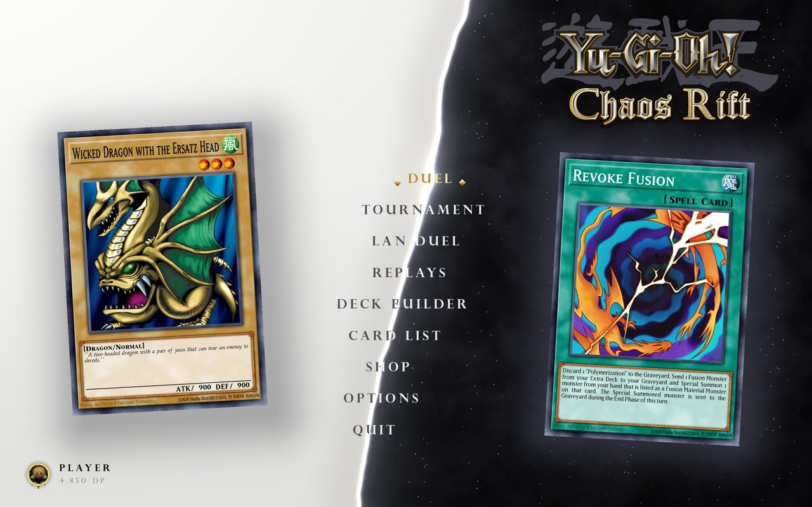
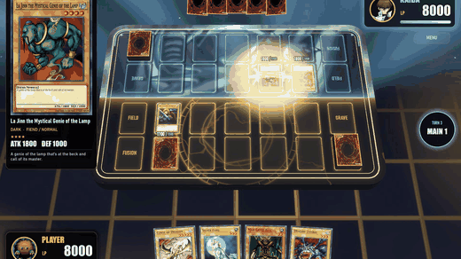
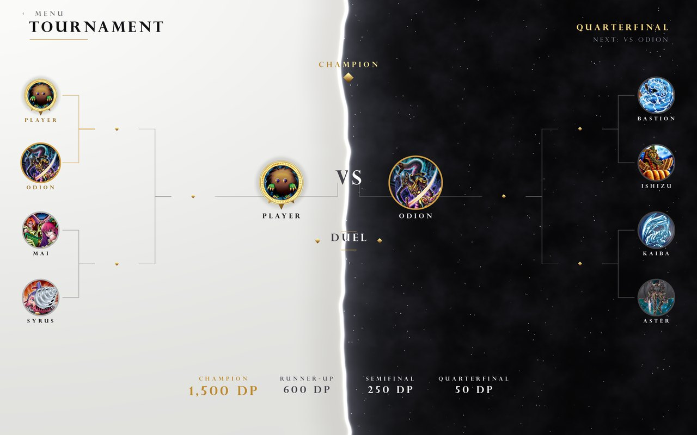
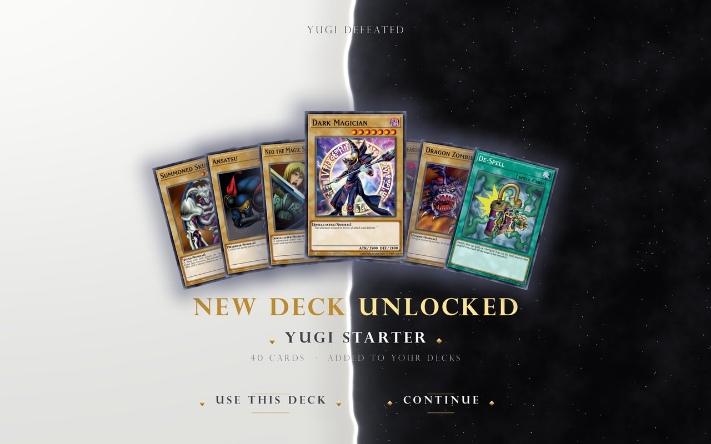
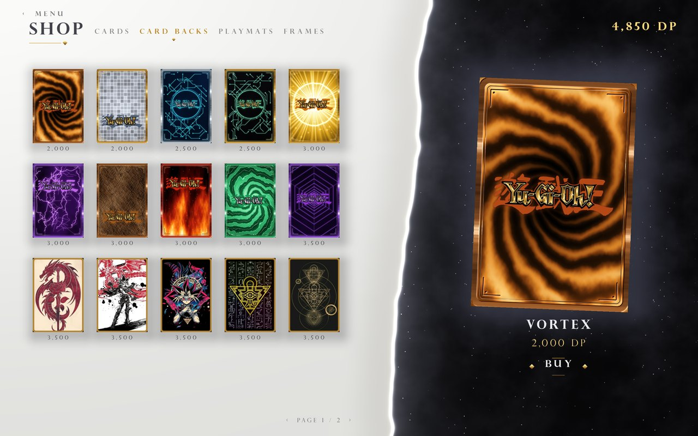
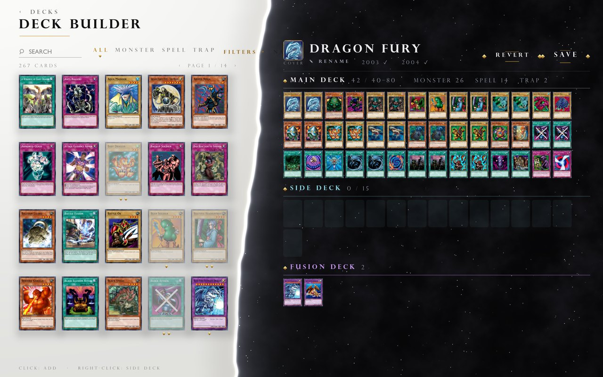
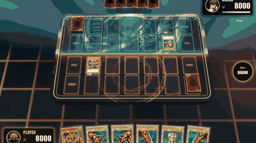
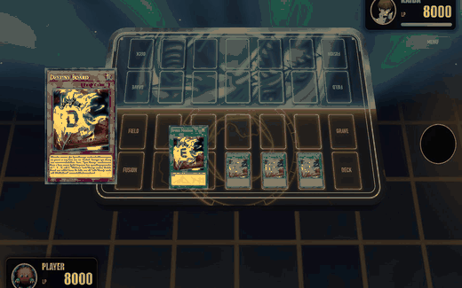

<h1 align="center">Chaos Rift</h1>
<p align="center"><b>All three Power of Chaos games in one, rebuilt and finished.</b></p>
<p align="center">
  <a href="https://3good5you.itch.io/chaos-rift"><b>Download free for Windows and macOS</b></a>
</p>



Yugi the Destiny, Kaiba the Revenge and Joey the Passion were three separate games. Each had a single opponent, its
own card pool and its own save, so the deck you built against Yugi stayed with Yugi. Chaos Rift merges them into one
game with one collection, then adds what the series never got: Jaden as a fourth rival, more than 2,000 cards, the
Egyptian Gods, a tournament, LAN duels, and a CPU that is properly hard to beat.

It's free and there's no account. The only shop takes Duel Points you win by playing.



## The cards

More than 2,000 cards, all in HD, and every effect is scripted against the real rules: chains, flip effects, fusions,
rituals, counters, coin flips and dice. Pick the 2003 or the 2004 ban list in Options.

The Egyptian Gods are in. Obelisk wipes your opponent's side of the field, Slifer grows with your hand and cuts down
whatever your opponent summons, and Ra trades your Life Points for raw attack. Nothing can respond to their Normal
Summon. Each one costs 9,000 DP in the shop, and once in a while a rival turns up running a God deck of their own.

## Four rivals

Yugi, Kaiba, Joey and Jaden each have a ladder of decks, from their starter up to an expert build. The CPU plays its
options out on copies of the duel before it commits to one. It never looks at your hand or your face-down cards to do
it, and between games of a match it side-decks against what you showed it. Leave your field open and it will notice.

## Ways to play

| Mode | |
|---|---|
| Regular | One duel, or a best-of-three match with side decking between games |
| Gauntlet | Four rivals back to back with one deck, and your Life Points carry over |
| Pack Duel | Open six packs and build a deck from what you pulled |
| Limited Duel | A different restriction on your collection each day |
| Legend | A rival with their strongest deck, for the biggest payout |
| Chaos Duel | Every third turn a new rule kicks in for both players |
| Challenges | Eight puzzles where you have one turn to win |
| Tournament | Eight duelists in a bracket, prizes by where you finish |
| LAN Duel | Play a friend on the same network |
| Replays | Save any duel and watch it back |



## Collecting

You earn Duel Points after every duel, even a loss. Wins also drop cards, and cards you already own three copies of
are taken out of the reward pool, so the drops keep being new. Beat a rival for the first time and their starter deck
is yours. The shop sells every card in the game, not just the ones you've seen.



The shop also has 31 card backs, 20 playmats and 18 profile frames. Each playmat changes the world under the duel
table, and a few can only be won by taking the tournament.



## Deck builder

Search by name, filter by type, attribute, level and owned or missing, and sort the results. Decks have Main, Side
and Fusion zones and a cover card. Import and export `.ydk` files and the original games' `.ydc` decks, so old decks
still work.



## The duel itself

A 3D duel table with attack lunges, summon flashes, chain links and destruction effects. The soundtrack mixes music
from Master Duel and the original Power of Chaos games, with sound effects made for this game. Winning with Exodia
or Destiny Board plays out as a full finish instead of a text box.





Duels move faster than the originals: three animation speeds, Space to jump to the next phase, right click to go back
or pass, and a double-click on your deck to concede.

## Small things that save time

In the deck builder:
- Add a Fusion monster and it offers to add its materials, plus Polymerization for the classic Fusions.
- Add a Ritual monster and it offers the Ritual Spell, and the other way round.
- Add a card that names another card, like Thousand Knives naming Dark Magician, and it offers that card too.
- Saving a deck with a Fusion that's missing its materials warns you first, with a button to add them.
- Import and export `.ydk` and the original games' `.ydc`. Copy, rename and set a cover card for any deck.

In a duel:
- You're only asked to chain when your opponent does something you could answer, or a card you set is waiting for that moment.
- Right click is back, pass or cancel. Space moves to the next phase. Double-click your deck to concede.
- Attacking a monster always asks you to confirm the target, so a stray click never throws an attack away.
- Hover any card for its full text, including the opponent's face-up cards. Face-down cards stay hidden.
- Music and sound sliders are in the duel menu, and there are three animation speeds.

Around the game:
- New cards get a NEW tag in the card list until you look at them.
- Your save, decks and Duel Points carry over when you install an update.

## Status

Version 1.0. The Windows build is the one that gets played and tested. A macOS build is included but hasn't been run on
a real Mac yet, so reports are welcome.

The CPU still makes the odd strange play, and many of the newer cards have only been checked by the automated tests
and not by hand. If a card misbehaves, save the replay and open an issue.

Planned: online duels, more rivals and decks, and more card backs and playmats.

## How it's built

- `game/Engine` is the duel engine: plain C# on .NET 8, no dependency on Godot. A duel is a starting setup plus a list
  of commands, and that one idea is what replays, LAN play and the CPU's look-ahead are all built on.
- `game/Engine.Check` is the test program. It runs ruling scenarios, plays CPU-vs-CPU duels, checks that two LAN
  peers stay in sync and that replays play back the same. It is also where the CPU gets trained and measured.
- `game/Godot` is the game (Godot 4.7, C#). The screens are built in code, not in the editor.
- `game/tools` has the packaging script and the generators for the playmats, card backs and sound effects I made.

## Building

You need the [.NET 8 SDK](https://dotnet.microsoft.com/download) and [Godot 4.7 .NET](https://godotengine.org/download).

Run the engine tests (no Godot needed):

```bash
dotnet run --project game/Engine.Check -c Release
```

Run the game:

```bash
dotnet build game/Godot/PoC.csproj
godot --path game/Godot
```

The art and audio are not in this repository, so the game will not start from a fresh clone. [ASSETS.md](ASSETS.md)
explains what is missing and how to get it from an installed copy.

## Reporting bugs

Save a replay of the duel where it went wrong (the button is on the results screen) and attach it to an issue. A
replay reproduces the whole duel on my machine, which makes most bugs much quicker to find.

Fixes for card rulings are welcome. Please add a scenario to `game/Engine.Check/Scenarios.cs` that fails without your
change.

## Legal

This is an unofficial fan project. It is free, has no ads, and I do not take donations for it.

Yu-Gi-Oh!, Power of Chaos, and the card names, characters and artwork belong to their owners, including Konami and
Studio Dice/Shueisha. I am not affiliated with or endorsed by any of them. If you hold rights to something here and
want it gone, open an issue and I will remove it.

The code is under the [MIT License](LICENSE). That covers the code only.
