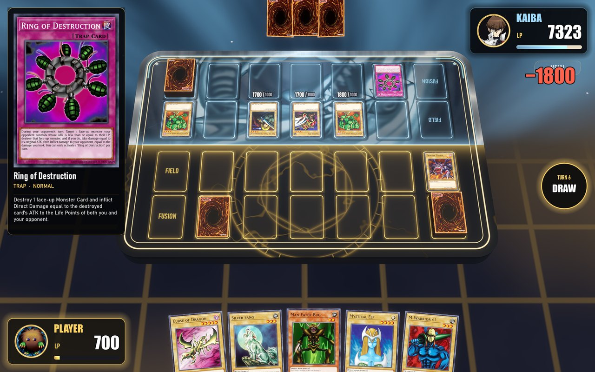

<h1 align="center">CHAOS RIFT</h1>
<p align="center"><b>A free, fan-made duel simulator. 2,000+ cards, a CPU that thinks ahead, and a look of its own.</b></p>
<p align="center">
  <a href="ITCH_URL"><b>Download for Windows / macOS</b></a> ·
  <a href="#features">Features</a> ·
  <a href="#build-from-source">Build from source</a> ·
  <a href="#legal">Legal</a>
</p>


Chaos Rift is a ground-up remake of the classic *Power of Chaos* PC duels: the same era of cards and rules, rebuilt on a
new engine with a 3D duel table, seven ways to play, a full collection to earn, and LAN duels against a friend.
No accounts, no timers, no purchases. Install and duel.



## Features

### 2,000+ cards, every effect scripted
- **2,015 cards** in the pool, each with its real effect, not a simplified stand-in: chains, flip effects, tributes, fusions,
  rituals, counters, coin tosses, dice and continuous effects all resolve by the rules.
- **15,000+ lines of card scripts**, checked by an automated harness that plays hundreds of full duels and walks scripted
  rulings before every release.
- **Two ban lists** (2003 and 2004 formats), switchable in Options.

### Rivals worth beating
- **Four rivals** (Yugi, Kaiba, Joey, Jaden), each with a ladder of decks that grows from starter to expert as you win.
- **A CPU that looks ahead.** It replays its options on copies of the duel with your hidden cards re-dealt (it never peeks),
  plays both sides forward, and picks the line that leaves the best board. It also side-decks against what you showed it
  between the duels of a match.

### Seven ways to duel
| Mode | What it is |
|---|---|
| **Regular** | Single duel or best-of-three match with side decking |
| **Gauntlet** | Four rivals in a row, one deck, your Life Points carry over |
| **Pack Duel** | Open six packs, build a deck from what you pulled, duel with it |
| **Limited Duel** | A rule of the day reshapes your collection |
| **Legend** | A rival at full power, for the biggest single payout |
| **Chaos Duel** | Every third turn the rift rewrites a rule: double draws, no battle, ATK surges |
| **Challenges** | Eight win-this-turn puzzles with exactly one answer |

Plus an **eight-duelist Tournament** with a mirrored bracket and prizes by finishing place, **LAN Duel** for two PCs on one
network, and **Replays** you can save and watch back.


### A collection to earn
- Win cards after every duel; spend Duel Points in the **Shop** on the cards you are missing.
- **Dozens of card backs, playmats and profile frames**, including prize mats only a tournament champion gets.
- **Deck Builder** with Main / Side / Fusion zones, one-row filters, deck covers, and import / export of `.ydc` and `.ydk`
  deck files.


### Special finishes
Winning by Exodia does not end on a text box. Exodia, Destiny Board, deck-out and the other alternate wins each get
their own staged finish.

### Built to feel good
- A 3D duel table with a playmat world for each side, attack lunges, summon bursts and chain links.
- The **Chaos Rift** look: every menu is one sheet torn in two, light on one side and dark on the other.
- Right click is always "back" or "pass"; Space moves to the next phase; double-click your Deck to surrender.

## Under the hood
- **`game/Engine`**: a deterministic duel engine in C# (.NET 8) with no engine or UI dependency. A duel is a setup plus a
  command log, so replays, LAN lockstep and the CPU's look-ahead all rebuild the same duel from the same log.
- **`game/Engine.Check`**: the test harness. Scenarios for rulings, random and CPU-vs-CPU duels, LAN lockstep, replay
  round-trips, and tools to train and measure the CPU.
- **`game/Godot`**: the game itself (Godot 4.7, C#). Every screen is built in code on a small shared kit.
- **`game/tools`**: packaging (Windows installer, macOS image) and the generators for the game's own mats, backs and sounds.

## Build from source

You need the [.NET 8 SDK](https://dotnet.microsoft.com/download) and [Godot 4.7 (.NET)](https://godotengine.org/download).

```bash
# engine + all checks (no Godot needed)
dotnet run --project game/Engine.Check -c Release
```

```bash
# the game
dotnet build game/Godot/PoC.csproj
godot --path game/Godot
```

This repository holds **code only**. The game's art and audio are not here (see [ASSETS.md](ASSETS.md)); to run from
source, install the release build and copy its asset folders into `game/Godot/`, as described there.

## Contributing
Bug reports with a saved replay are the most useful thing you can send: a replay reproduces the duel exactly. Card
ruling fixes are welcome; add a scenario to `game/Engine.Check/Scenarios.cs` that fails before your fix.

## Legal
Chaos Rift is an **unofficial, non-commercial fan project**. It is free, has no ads, and accepts no donations.

Yu-Gi-Oh! and all related card names, characters and artwork are trademarks and copyrights of their respective owners,
including Konami and Studio Dice/Shueisha. This project is not affiliated with, endorsed by or sponsored by any of them.
If you are a rights holder and want something removed, open an issue and it will be taken down.

The source code in this repository is released under the [MIT License](LICENSE). That licence covers the code only, not
any third-party names, card text or artwork.
